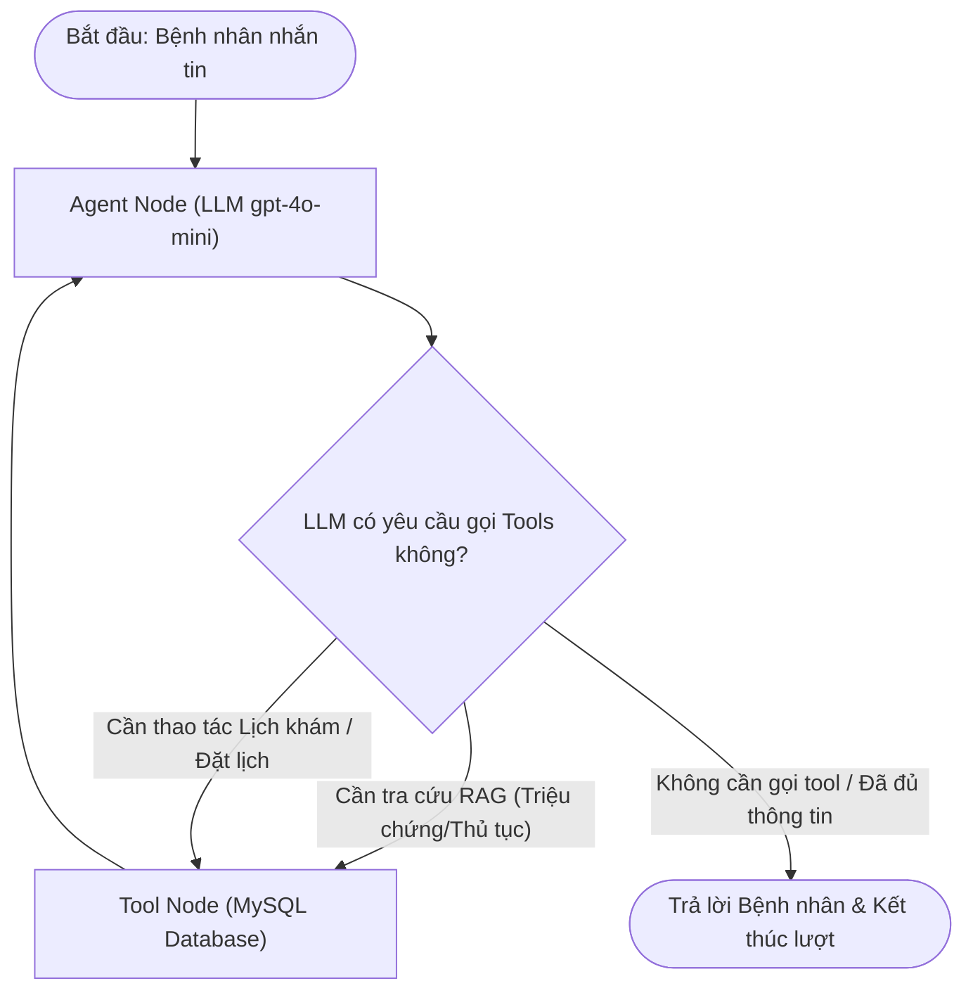
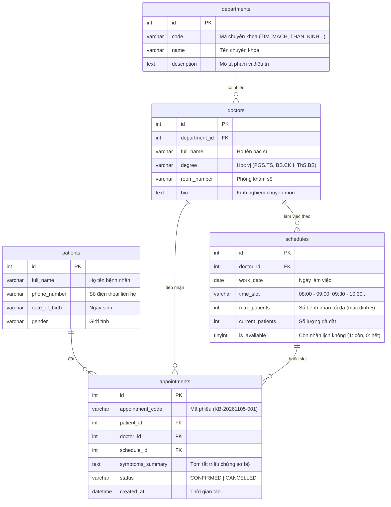

# 📋 KẾ HOẠCH NÂNG CẤP HỆ THỐNG V2: LANGGRAPH TOOL-CALLING HOSPITAL AGENT

> **Dự án**: Trợ lý Y tế & Đặt lịch khám bệnh thông minh (Hospital Booking Agent v2)  
> **Kiến trúc v2**: Single Agent with Tool Calling (LangGraph ReAct StateGraph) + Cơ sở dữ liệu **MySQL** + Hybrid RAG (100 bài viết YouMed + Quy trình bệnh viện)  
> **Phần mềm quản trị CSDL**: DataGrip / DBeaver / MySQL Workbench  
> **Phạm vi (Scope)**: Tập trung vào giải đáp thủ tục bệnh viện, tư vấn sơ bộ triệu chứng và đặt lịch khám. **Cấp cứu y tế là OUT-OF-SCOPE** (chỉ có dòng miễn trừ trách nhiệm y khoa thông thường).  
> **Trạng thái**: Đang lập kế hoạch (Planning Phase) - Chưa triển khai mã nguồn.

---

## 🎯 1. So sánh Phiên bản V1 vs Phiên bản V2

| Tiêu chí | Phiên bản V1 (Hiện tại) | Phiên bản V2 (Mục tiêu nâng cấp) |
| :--- | :--- | :--- |
| **Kiến trúc điều phối** | Chuỗi Router tuần tự cứng (`triage.py` + `main.py`) | **LangGraph ReAct StateGraph**: 1 Agent thông minh tự quyết định gọi công cụ linh hoạt theo ngữ cảnh |
| **Cơ sở dữ liệu** | Chỉ có Vector DB (ChromaDB) | **MySQL Database** lưu trữ Bác sĩ, Chuyên khoa, Lịch làm việc và Phiếu đặt lịch (Khớp 100% với nhóm) |
| **Tính năng Đặt lịch** | Chỉ dừng ở gợi ý chuyên khoa (`BOOKING_REDIRECT`) | **Quy trình đặt lịch đầy đủ vào MySQL**: Tra cứu bác sĩ, kiểm tra khung giờ trống thời gian thực, lưu phiếu khám |
| **Dữ liệu y khoa** | 3 trang PDF mẫu | **100 bài viết y khoa thực tế YouMed** (đã nạp sẵn 1.555 chunks) + PDF Quy trình bệnh viện |
| **Bộ nhớ hội thoại** | Biến mảng Python tạm thời | **LangGraph Checkpointer (MemorySaver)** lưu lịch sử phiên chat (`thread_id`) bền vững |
| **Đánh giá (Evaluation)**| File `evaluate.py` rỗng 0 bytes | **Bộ Benchmark hoàn chỉnh**: Đánh giá Tool Calling Accuracy, RAG Hit Rate và Tỉ lệ đặt lịch thành công |
| **Giao diện (UI)** | Terminal console | **Web Chat trực quan (Streamlit)** hiển thị danh sách bác sĩ và thẻ phiếu khám |

---

## 💡 2. Nguyên lý Phân công: RAG vs Database Tools

Hệ thống phân tách rạch ròi giữa 2 loại dữ liệu để đạt hiệu năng và độ chính xác cao nhất:

1. **RAG (ChromaDB) — Xử lý dữ liệu văn bản tự do (Unstructured Text)**:
   - Dùng cho 100 bài viết YouMed & PDF thủ tục.
   - Nhiệm vụ: Tìm kiếm theo độ tương đồng ngữ nghĩa để **tư vấn triệu chứng** và **giải đáp quy trình viện phí/BHYT**.
2. **Database Tools (MySQL) — Xử lý dữ liệu có cấu trúc thời gian thực (Structured Data)**:
   - Dùng cho các bảng Bác sĩ, Lịch trực, Slot khám trống.
   - Nhiệm vụ: Chạy câu lệnh SQL chuẩn xác để **kiểm tra slot trống thời gian thực** và **lưu phiếu đặt hẹn** mà không sợ sai lệch.

---

## 🏗️ 3. Kiến trúc LangGraph ReAct StateGraph



- **`AgentNode`**: Suy luận logic từ câu nói của người bệnh, quyết định khi nào cần tra cứu RAG và khi nào cần gọi lệnh SQL vào MySQL.
- **`ToolNode`**: Đóng vai trò là cầu nối thực thi: truy vấn ChromaDB hoặc chạy câu lệnh SQL vào MySQL qua `pymysql` rồi trả dữ liệu sạch về cho LLM.
- **`Checkpointer`**: Ghi nhớ trạng thái trao đổi theo `thread_id` để bệnh nhân có thể trao đổi nhiều lượt liên tiếp (ví dụ: đổi ý chọn giờ khác, cung cấp thêm số điện thoại).

---

## 🗄️ 4. Thiết kế Cơ sở dữ liệu MySQL

Toàn bộ bảng được thiết kế chuẩn chuẩn hoá quan hệ, hỗ trợ mã hóa tiếng Việt `utf8mb4` và engine `InnoDB`:



---

## 🛠️ 5. Danh mục 6 Tools Tinh Gọn của Agent

### Nhóm 1: RAG Tools (Tra cứu Tri thức)
1. **`search_hospital_faq(question: str)`**:
   - Truy vấn ChromaDB lọc `category="hospital_procedures"` trả lời thủ tục, viện phí, BHYT.
2. **`search_symptoms_and_triage(symptoms: str)`**:
   - Truy vấn ChromaDB lọc `category="symptoms"` (từ 100 bài viết YouMed).
   - Trả về căn cứ lâm sàng, tên bài viết, bác sĩ biên soạn và gợi ý chuyên khoa.

### Nhóm 2: MySQL Tools (Thao tác Dữ liệu Đặt lịch)
3. **`list_departments_and_doctors(department_name: Optional[str])`**:
   - Chạy lệnh SQL vào MySQL lấy danh sách chuyên khoa hoặc bác sĩ theo khoa.
4. **`check_doctor_available_slots(doctor_id: int, date: str)`**:
   - Chạy SQL kiểm tra các khung giờ khám còn trống (`current_patients < max_patients`) của bác sĩ theo ngày.
5. **`book_appointment(patient_name: str, phone: str, dob: str, doctor_id: int, schedule_id: int, symptoms: str)`**:
   - Thêm hồ sơ vào bảng `patients` (nếu chưa có), tạo dòng mới trong bảng `appointments`, tăng `current_patients` trong bảng `schedules` và trả về mã phiếu hẹn (ví dụ: `KB-20261105-001`).
6. **`lookup_appointment(phone_number: str)`**:
   - Chạy lệnh `SELECT` tra cứu lịch khám đã đặt bằng số điện thoại người bệnh.

---

## 📊 6. Kế hoạch Đánh giá Định lượng (`Script/evaluate.py`)

File [`evaluate.py`](file:///c:/Users/HUY0406/OneDrive/Desktop/HK5/LLMS/hospital_booking_chatbot/Script/evaluate.py) sẽ được xây dựng gồm 3 bài test đo lường:

1. **Tool Calling Accuracy**: Đo tỉ lệ gọi đúng Tool và trích xuất đúng tham số (tên bác sĩ, ngày khám, số điện thoại) từ câu nói người bệnh.
2. **RAG Retrieval Hit Rate**: Đo khả năng truy xuất đúng bài viết YouMed theo triệu chứng mô tả.
3. **End-to-End Booking Success Rate**: Đánh giá độ thành công của luồng hội thoại từ tư vấn triệu chứng đến lúc lưu thành công vào MySQL.

---

## 📅 7. Lộ trình Triển khai 5 Bước

```text
[Bước 1: Thiết lập MySQL & Chạy Script tạo bảng trên DataGrip]
  ├── Viết file schema.sql chuẩn MySQL (InnoDB, utf8mb4)
  ├── Mở DataGrip kết nối MySQL, chạy schema.sql tạo 5 bảng
  └── Chạy seed dữ liệu mẫu (Chuyên khoa, Bác sĩ, Lịch trực 7 ngày tới)
        │
[Bước 2: Xây dựng Bộ 6 Tools kết nối MySQL & RAG]
  ├── Viết file Script/tools.py chứa 2 hàm RAG và 4 hàm SQL
  └── Kiểm thử các tool độc lập qua Python
        │
[Bước 3: Xây dựng LangGraph ReAct Agent]
  ├── Tạo AgentState, AgentNode và ToolNode
  ├── Cấu hình Checkpointer lưu phiên chat
  └── Chạy thử nghiệm tương tác dòng lệnh (CLI)
        │
[Bước 4: Xây dựng Benchmark Đánh giá (evaluate.py)]
  └── Chạy kiểm thử tự động và xuất báo cáo điểm số
        │
[Bước 5: Giao diện Web Trực quan (Streamlit)]
  └── Dựng giao diện chat hiện đại kết nối trực tiếp với LangGraph Agent
```
