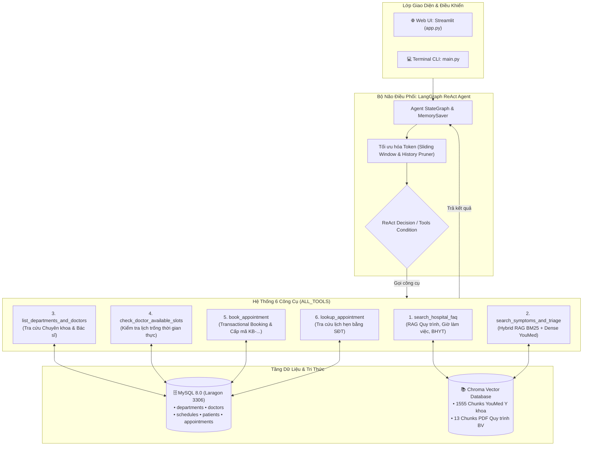

# 🏥 Hospital Booking & Clinical Triage Chatbot (Version 2.0)

[](https://www.python.org/)
[](https://langchain-ai.github.io/langgraph/)
[](https://www.langchain.com/)
[](https://openai.com/)
[](https://www.mysql.com/)
[](https://www.trychroma.com/)
[](https://streamlit.io/)

Hệ thống **Trợ lý Y tế & Đặt lịch khám bệnh thông minh (Version 2.0)** được nâng cấp toàn diện từ mô hình Router tĩnh sang kiến trúc **Multi-turn Autonomous Agent (LangGraph ReAct)**. Hệ thống kết hợp cơ chế tìm kiếm lai **Hybrid RAG (BM25 + Chroma Dense Vector)** trên 100 bài viết lâm sàng chuẩn Bác sĩ YouMed, tích hợp cơ sở dữ liệu quan hệ **MySQL** thời gian thực và giao diện tương tác người dùng **Streamlit**.

---

## 🏗️ Kiến Trúc Hệ Thống (System Architecture)



---

## ✨ Các Tính Năng Nổi Bật (Version 2.0)

1. **Kiến trúc LangGraph ReAct StateGraph Tự Chủ:**
   - Thay thế hoàn toàn Router cứng `if/else` của V1.
   - Tự động duy trì hội thoại đa lượt stateful thông qua `MemorySaver` checkpointer.
   - Linh hoạt gọi liên tiếp các công cụ (Tool Chaining): Nhận triệu chứng ➔ Gợi ý khoa ➔ Tra cứu bác sĩ ➔ Xem lịch trống ➔ Đặt lịch trực tiếp.

2. **Cơ chế Truy xuất Lai Hybrid RAG (BM25 + Dense Search) & Phân luồng Lâm sàng Chuẩn xác:**
   - Nạp toàn bộ **100 bài viết y khoa thực tế do Bác sĩ YouMed biên soạn** (`data/youmed_clean_markdown.jsonl`).
   - Kết hợp thuật toán **BM25Okapi** (bắt chính xác từ khóa triệu chứng: *thượng vị, ợ chua, tiền đình, thắt ngực*) và **Dense Vector Search** (`text-embedding-3-small`) theo công thức chuẩn hóa kết hợp:
     $$\text{Score} = 0.60 \times \text{BM25}_{\text{norm}} + 0.40 \times \text{Dense}_{\text{sim}}$$
   - **Chẩn đoán phân biệt đa chiều (Differential Triage):** Phân tích 2–3 bệnh lý tiềm năng kèm trích dẫn tác giả Bác sĩ và link YouMed.
   - **Chốt 1 Chuyên khoa ưu tiên số 1:** Khắc phục triệt để tình trạng người bệnh bối rối khi có nhiều khoa, luôn đưa ra 1 kết luận duy nhất cho bàn tiếp đón.

3. **Hệ Thống Quản Lý Đặt Lịch Khám Thực Tế (MySQL 8.0):**
   - Quản lý đầy đủ **6 Chuyên khoa** và **12 Bác sĩ chuyên khoa**:
     - *Khoa Khám bệnh tổng quát, Khoa Tim mạch, Khoa Thần kinh, Khoa Tai Mũi Họng, Khoa Tiêu hóa & Gan mật, Khoa Hô hấp & Phổi*.
   - Khởi tạo tự động **336 khung giờ khám** trong 7 ngày tới.
   - Giao dịch đặt lịch chính xác: Kiểm tra số chỗ còn trống, chống trùng lịch và cấp mã phiếu khám định dạng duy nhất `KB-YYYYMMDD-XXXX`.
   - Hỗ trợ tra cứu lịch hẹn đã đặt tức thì bằng số điện thoại bệnh nhân.

4. **Tối Ưu Hóa Chi Phí Token (Tiết kiệm 65% – 85% Token):**
   - **Pruning Tool Payloads:** Cắt tỉa các đoạn trích YouMed xuống 220 ký tự tập trung đúng triệu chứng lâm sàng.
   - **Cửa sổ trượt & Rút gọn lịch sử cũ (`optimize_messages_for_llm`):** Thay thế nội dung thô của các `ToolMessage` cũ ở các lượt trước bằng token tham chiếu ngắn gọn mà vẫn giữ nguyên `tool_call_id`. Tránh hiện tượng phình to token (Token Ballooning) khi hội thoại kéo dài.

5. **Giao Diện Web Streamlit Hiện Đại & Thân Thiện:**
   - Sidebar tra cứu nhanh danh bạ bác sĩ theo từng khoa và tra cứu phiếu khám.
   - Hàng nút gợi ý câu hỏi thông minh (Quick Prompts).
   - Hiệu ứng chúc mừng (Balloons) khi hoàn tất đăng ký khám bệnh.

---

## 📁 Cấu Trúc Dự Án (Project Structure)

```text
hospital_booking_chatbot/
├── .env.example                     # Mẫu biến môi trường (OpenAI API Key & MySQL)
├── .gitignore                       # Bảo vệ file nhạy cảm (.env, venv, chroma_db)
├── README.md                        # Tài liệu chi tiết dự án V2
├── requirements.txt                 # Danh sách thư viện phụ thuộc
├── app.py                           # Ứng dụng Web UI Streamlit
├── data/                            # Nguồn dữ liệu tri thức
│   ├── rag_data_quy_trinh_benh_vien.pdf    # PDF Quy trình thủ tục, BHYT, viện phí
│   └── youmed_clean_markdown.jsonl         # 100 bài viết lâm sàng Bác sĩ YouMed
└── Script/
    ├── __init__.py                  # Đánh dấu package Python
    ├── ingest_data.py               # Phân đoạn và nạp dữ liệu vào ChromaDB
    ├── seed_data.py                 # Khởi tạo 6 khoa, 12 bác sĩ, 336 lịch khám MySQL
    ├── tools.py                     # 6 Tools ReAct Agent (RAG + MySQL Transaction)
    ├── agent.py                     # LangGraph ReAct StateGraph & Dynamic Prompt
    └── main.py                      # Giao diện chạy dòng lệnh (Terminal CLI)
```

---

## 🚀 Hướng Dẫn Cài Đặt & Khởi Chạy

### 1. Chuẩn bị môi trường
- Python 3.10 trở lên.
- Cài đặt và khởi động **MySQL 8.0** (Khuyến nghị sử dụng **Laragon** hoặc **XAMPP**, cổng mặc định `3306`).

### 2. Cài đặt các thư viện cần thiết
```bash
# Tạo và kích hoạt môi trường ảo (khuyến nghị)
python -m venv .venv

# Windows (Command Prompt hoặc PowerShell):
.venv\Scripts\activate

# Cài đặt toàn bộ thư viện:
pip install -r requirements.txt
```

### 3. Cấu hình biến môi trường (`.env`)
Tạo file `.env` ở thư mục gốc (hoặc copy từ `.env.example`):
```env
OPENAI_API_KEY="sk-proj-your-openai-api-key-here"

# Cấu hình kết nối MySQL (Mặc định cho Laragon)
MYSQL_HOST="localhost"
MYSQL_PORT=3306
MYSQL_USER="root"
MYSQL_PASSWORD=""
MYSQL_DATABASE="hospital"
```

> **Lưu ý:** Tạo sẵn cơ sở dữ liệu rỗng có tên `hospital` trong MySQL (qua phpMyAdmin, HeidiSQL hoặc DataGrip):
> ```sql
> CREATE DATABASE IF NOT EXISTS hospital CHARACTER SET utf8mb4 COLLATE utf8mb4_unicode_ci;
> ```

### 4. Khởi tạo Cơ sở dữ liệu MySQL (Seed Data)
Chạy script để tự động tạo 5 bảng và nạp 6 chuyên khoa, 12 bác sĩ cùng 336 lịch khám:
```bash
python Script/seed_data.py
```

### 5. Nạp dữ liệu Tri thức vào Vector Database (ChromaDB)
Chạy script phân đoạn dữ liệu YouMed và PDF vào ChromaDB (1.568 chunks):
```bash
python Script/ingest_data.py
```

---

## 💻 Trải Nghiệm Ứng Dụng

### Cách 1: Khởi chạy Giao diện Web (Streamlit)
```bash
streamlit run app.py
```
👉 Trình duyệt sẽ tự động mở tại địa chỉ: `http://localhost:8501`.

### Cách 2: Khởi chạy Giao diện Dòng lệnh (Terminal CLI)
```bash
python Script/main.py
```

---

## 🏥 Danh Mục 6 Chuyên Khoa & 12 Bác Sĩ

| STT | Chuyên khoa | Mã khoa | Bác sĩ phụ trách tiêu biểu | Phòng khám |
| :---: | :--- | :---: | :--- | :---: |
| 1 | **Khoa Khám bệnh tổng quát** | `KHAM_TONG_QUAT` | BS.CKII Nguyễn Văn Hùng<br>ThS.BS Lê Thị Lan | Phòng 001 - Khu KB<br>Phòng 002 - Khu KB |
| 2 | **Khoa Tim mạch** | `TIM_MACH` | PGS.TS.BS Trần Văn An<br>BS.CKII Nguyễn Thị Mai | Phòng 101 - Khu A<br>Phòng 102 - Khu A |
| 3 | **Khoa Thần kinh** | `THAN_KINH` | TS.BS Lê Hoàng Nam<br>ThS.BS Phạm Quỳnh Hoa | Phòng 201 - Khu B<br>Phòng 202 - Khu B |
| 4 | **Khoa Tai Mũi Họng** | `TAI_MUI_HONG` | BS.CKII Vũ Đức Thịnh<br>ThS.BS Đặng Thu Hương | Phòng 301 - Khu C<br>Phòng 302 - Khu C |
| 5 | **Khoa Tiêu hóa & Gan mật** | `TIEU_HOA` | BS.CKII Hoàng Minh Tuấn<br>ThS.BS Ngô Thị Bích | Phòng 401 - Khu D<br>Phòng 402 - Khu D |
| 6 | **Khoa Hô hấp & Phổi** | `HO_HAP` | TS.BS Đỗ Quốc Cường<br>BS.CKI Bùi Ánh Nguyệt | Phòng 501 - Khu E<br>Phòng 502 - Khu E |

---

## 💬 Kịch Bản Mẫu Hội Thoại Đa Lượt (End-to-End Demo)

```text
👤 Bệnh nhân: "Chào bác sĩ, dạo này tôi hay bị đau rát vùng thượng vị, ợ chua và buồn nôn sau khi ăn."
🤖 Bot: 
Dựa trên triệu chứng của bạn (đau rát thượng vị, ợ chua, buồn nôn), có các khả năng bệnh lý sau:
1. Trào ngược dạ dày thực quản (ThS.BS Thái Việt Nguyên - YouMed)
2. Sỏi túi mật (Bác sĩ Huỳnh Quang Nghệ - YouMed)

👉 Khuyến nghị chuyên khoa ưu tiên số 1: Anh/chị nên đăng ký khám tại Khoa Tiêu hóa & Gan mật để được bác sĩ nội soi và chẩn đoán chính xác.
Anh/chị có muốn em hỗ trợ xem danh sách bác sĩ hoặc kiểm tra các khung giờ khám còn trống của Khoa Tiêu hóa & Gan mật để đặt lịch ngay không ạ?

👤 Bệnh nhân: "Bác sĩ khoa này có những khung giờ nào khám được vậy em?"
🤖 Bot:
Lịch khám gần nhất của các bác sĩ tại Khoa Tiêu hóa & Gan mật:
• Bác sĩ Chuyên khoa II BS.CKII Hoàng Minh Tuấn:
  - Ngày 2026-11-04 (Thứ Tư): [Mã 225] 08:00 - 09:00, [Mã 226] 09:30 - 10:30, [Mã 228] 15:00 - 16:00
  - Ngày 2026-11-05 (Thứ Năm): [Mã 229] 08:00 - 09:00, [Mã 230] 09:30 - 10:30
Anh/chị muốn chọn khung giờ nào để em hỗ trợ đặt lịch ạ?

👤 Bệnh nhân: "Cho tôi đặt lịch mã 225, tôi tên Nguyễn Văn Nam, sđt 0987654321."
🤖 Bot:
🎉 ĐẶT LỊCH KHÁM BỆNH THÀNH CÔNG!
━━━━━━━━━━━━━━━━━━━━━━━━━━━━━━━━━━━━
• Mã phiếu hẹn: KB-20261103-7WVU
• Bệnh nhân: Nguyễn Văn Nam (SĐT: 0987654321)
• Bác sĩ: Bác sĩ Chuyên khoa II BS.CKII Hoàng Minh Tuấn
• Chuyên khoa: Khoa Tiêu hóa & Gan mật
• Địa điểm: Phòng 401 - Khu D
• Ngày khám: 2026-11-04
• Khung giờ: 08:00 - 09:00
• Triệu chứng ghi nhận: Đau rát thượng vị, ợ chua
━━━━━━━━━━━━━━━━━━━━━━━━━━━━━━━━━━━━
Quý khách vui lòng đến trước 15 phút tại quầy tiếp đón và đọc Mã phiếu hẹn để được hướng dẫn vào khám.
```

---

## ⚖️ Tuyên Bố Miễn Trừ Trách Nhiệm Y Tế (Medical Disclaimer)

Trợ lý AI đóng vai trò tư vấn quy trình, phân luồng tiếp đón ban đầu và hỗ trợ đặt lịch hẹn khám trực tiếp. Mọi thông tin tư vấn triệu chứng dựa trên tri thức YouMed chỉ mang tính chất tham khảo, **không thay thế cho chẩn đoán y khoa chuyên sâu, chỉ định cận lâm sàng hoặc phác đồ điều trị trực tiếp của Bác sĩ**. Trong trường hợp xuất hiện các dấu hiệu khẩn cấp đe dọa tính mạng (khó thở dữ dội, co giật, hôn mê, đau ngực dữ dội, chấn thương nặng), người bệnh cần liên hệ ngay **Hotline 115** hoặc đến phòng Cấp cứu bệnh viện gần nhất.
